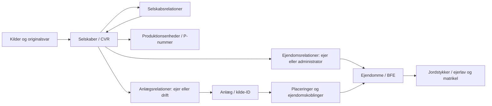

# Datamodel, version 1

Status: research- og pilotmodel pr. 2026-11-08. Modellen gør ikke kandidatfund eller API-status til verificerede juridiske forhold.

## Sammenhængen

Kildehenvisninger og kontrolstatus skal følge alle relationer, selv om pilene ikke er gentaget i diagrammet. Et CVR kan have flere ejendomme/anlæg, og et anlæg kan omfatte flere ejendomme. En administrator er ikke automatisk ejer eller driftsansvarlig. P-enheder og anlæg er forskellige objekter.

## Implementeret nu

### Researchtabeller

- `research/sources.csv`: `source_id` er nøgle. `url`, udgiver og titel angiver belæg; `document_date` er dokumentdato, når den er kendt. `researched_on` er researchdato, ikke præcist hentetidspunkt eller gyldighedsdato. `capture_status` viser, om råbelæg er arkiveret. `origin_system` beskriver ophav, når det er kendt.
- `research/company_candidates.csv`: `candidate_id` er nøgle, CVR er tekst på otte cifre. `source_ids` er en `|`-separeret liste af fremmednøgler til kilder. `candidate_kind` er en researchprioritering, ikke registreret selskabsstatus. `evidence_status` beskriver belæg for kandidatens navn/nummer. `current_cvr_status` og `relation_status` er særskilte kontroller. Noter om et salg, en fusion eller et navneskifte er kildeudsagn, ikke en implementeret selskabsrelation.

Researchtabellerne må ændres, når nye kilder og kontroller tilkommer; ændringer kan ses i Git, når de er versionsstyret. De må ikke bruges som bevis for en komplet selskabsstruktur. De hidtidige præcise researchklokkeslæt kendes ikke og er ikke rekonstrueret.

### Rådata

Hver hentning har sin egen mappe med `request.json`, `response.body` og eventuelt `response.headers`. Kildebytes ændres ikke. Manifestet indeholder URL, parametre, tidsstempler med UTC-offset, HTTP-/transportstatus og SHA-256 for svaret. Manglende body ved transportfejl er ikke et tomt resultat.

De to allerede eksisterende pilotforsøg er bevaret. Det første fejlede før et HTTP-svar; det andet gav HTTP 200. Ny hentning er implementeret i `scripts/fetch_matriklen.py`. Manifestet registrerer, at paginering ikke er dokumenteret eller fulgt.

### Kørselsmanifest

`data/runs/matriklen-labs/<run>/manifest.json` er indgangen til en bearbejdning. `status=complete` betyder kun, at den tekniske bearbejdning er skrevet færdig. Manifestet angiver kilde, inputhash, metadatahash, kodeversion/-hash og hash af outputfilerne. Fra metodeversion 2 er `input_capture` relativ til kørselsmappen (`input_path_base=run_directory`); den præcise kode gemmes også i `method/transform_matriklen.py` og medtages i outputhashene. `verification_status=source_only` og `coverage_status=unverified` må ikke omfortolkes til faglig verifikation.

Output skrives i en midlertidig mappe og flyttes samlet til den valgte kørselsmappe. Eksisterende kørsler afvises. Ukendt JSON-topstruktur, dublerede objektnøgler, ugyldige JSON-tal, forkert inputhash og mislykkede HTTP-svar afvises før et færdigt run oprettes. Et kendt format med to tomme lister er derimod et teknisk gyldigt `empty_result`.

### Ejendomsrelationer: `processed/relations.csv`

Én række svarer til ét objekt i API'ets `ejer`- eller `administrerer`-liste. Ingen poster fjernes som dubletter. CSV-rækkernes antal afstemmes med kildens antal objekter.

| Felt | Betydning |
|---|---|
| `relation_id` | Capture-ID, rolle og nulbaseret arrayindeks. Identificerer kildeobservationen, ikke et globalt juridisk forhold |
| `cvr` | Det søgte CVR fra hentningsmanifestet |
| `bfe`, `bfe_state` | Kildens BFE som tekst, hvis positivt heltal/ciffertekst. Tilstand: `present`, `missing`, `null` eller `invalid` |
| `role` | API'ets listebetegnelse uændret: `ejer` eller `administrerer` |
| `source_status` | Kildens tekst, eksempelvis `gældende` eller `historisk`; ikke vores kontrolstatus |
| `virkning_fra_original` | Hele kilde-datostrengen inklusive offset og eventuelt `[Europe/Copenhagen]`. Ingen start-/slutdato udledes |
| `actual_share_state`, `actual_share_numerator`, `actual_share_denominator` | Faktisk ejerandel fra `faktiskEjerandel`; tilstand og brøk holdes adskilt |
| `registered_share_state`, `registered_share_numerator`, `registered_share_denominator` | Tinglyst ejerandel fra `tinglystEjerandel`; selvstændig brøk |
| `source_capture_id`, `source_pointer`, `source_sha256` | Sporbarhed til råmappe og konkret objekt, eksempelvis `/ejer/0`, samt råfilens hash |
| `verification_status` | `source_only`: gengivelse af kilde, ikke uafhængig bekræftelse |

Andelstilstande er `present`, `missing`, `null` og `invalid`. Tæller `0` bevares som nul og bliver ikke til en manglende værdi. Positiv nævner kræves for normalisering. Ugyldige værdier forbliver i råsvaret og markeres i kvalitetsloggen. Manglende/nonnumeriske BFE medfører en bevaret relationsrække med tomt BFE og en kontrolbemærkning. Ukendte statusser og ekstra felter markeres; nye topstrukturer kræver en eksplicit metodeændring.

### Ejendomsreferencer: `processed/properties.csv`

Afledt oversigt med én række per forskellig gyldig BFE-tekst. Felter: `bfe`, `relation_count`, `relation_ids` (separeret med `|`), `source_capture_id`, `source_sha256`, `verification_status`. Flere relationer til samme BFE samles som henvisninger, ikke som én foretrukken ejerrelation. Ingen adresse, matrikel, areal eller ejendomstype udfyldes uden selvstændigt belæg.

Listen er fundne ejendomsreferencer fra én hentning, ikke et autoritativt ejendomsregister. Rækker uden gyldigt BFE indgår kun i relationstabellen og tælles særskilt i profilen.

### Kvalitet

`quality/profile.json` indeholder antal kilderækker, antal outputrækker, kildefelter, roller/statusser, forskellige gyldige BFE og kontrolfund. `quality/issues.csv` har `issue_id`, `severity`, `code`, `source_pointer`, `bfe`, `message`.

En forskel mellem faktisk og tinglyst ejerandel markeres til undersøgelse, uden at en andel vælges som korrekt. Generelle spørgsmål om datosemantik og dækning er altid synlige. Teknisk kontrol og fagligt review er forskellige forhold; væsentlige reviewbeslutninger registreres i `research/decisions.md`.

## Næste tabeller: defineret, endnu ikke udfyldt

| Tabel | Nøgle og minimumsfelter |
|---|---|
| `companies` | CVR; officielt navn, status, kilde, observationstidspunkt, kontrolstatus |
| `company_names` | Navneobservation-ID; CVR, navn, navnetype, fra/til når dokumenteret, kilde |
| `company_relations` | Relations-ID; fra-CVR, til-CVR, relationstype, ejerandel som kildeværdi, virknings-/registreringsperioder når kendte, kilde, kontrolstatus |
| `production_units` | P-nummer; CVR, navn, adresse-ID, status, datoer, kilde |
| `parcels` | Kildens jordstykke-ID; BFE, ejerlavskode, matrikelnummer, areal, kilde. Matrikelnummer alene er ikke en nøgle |
| `facilities` | Lokalt anlægs-ID; navn, type, kilde-ID med systemnavn, status, placering og koordinatsystem når kendt, kilde |
| `facility_relations` | Relations-ID; anlægs-ID, CVR, præcis rolle, datoer, kilde, kontrolstatus |
| `facility_properties` | Koblings-ID; anlægs-ID, BFE/jordstykke-ID, matchgrundlag, kilde, kontrolstatus |

Der oprettes først datafiler til disse tabeller, når der er kildebelagte rækker. Modellen er således ikke et løfte om, at selskabsstruktur eller anlægsbestand allerede er kortlagt. Sammenkoblinger på navn/adresse alene skal blive kandidater til kontrol.

## Fælles formater

CSV: UTF-8, komma, én overskriftsrække, citerede felter efter CSV-regler. JSON: UTF-8. Identifikatorer behandles som tekst ved import i regneark. Ukendte værdier er tomme felter og forklares med tilstand/kontrolstatus eller kildereference; de udfyldes ikke med gæt. Publiceringsdato, opslagstid og virknings-/registreringsdato er forskellige felter. Pipelister bruges kun til kilde- og række-ID'er, som ikke selv indeholder `|`.
